<div align="center">


# Shifting Manor

**A haunted-manor deduction game where entire 3×3 wings rotate 90° every few moves — playable manually, in Human vs AI Duel mode, or autonomously live by a 24-rule forward-chaining Caretaker AI.**

[](https://muhammadghiffari.github.io/shifting-manor/)
[](https://muhammadghiffari.github.io/shifting-manor/play.html?auto=1&agent=b3&mode=explorer&seed=HAUNT-4F2A)
[](https://muhammadghiffari.github.io/shifting-manor/play.html?duel=1&mode=explorer&seed=HAUNT-4F2A)

[](https://github.com/muhammadghiffari/shifting-manor/actions/workflows/ci.yml)
[](https://github.com/muhammadghiffari/shifting-manor/actions/workflows/pages.yml)
[](pyproject.toml)
[](pyproject.toml)
[](LICENSE)

<br />

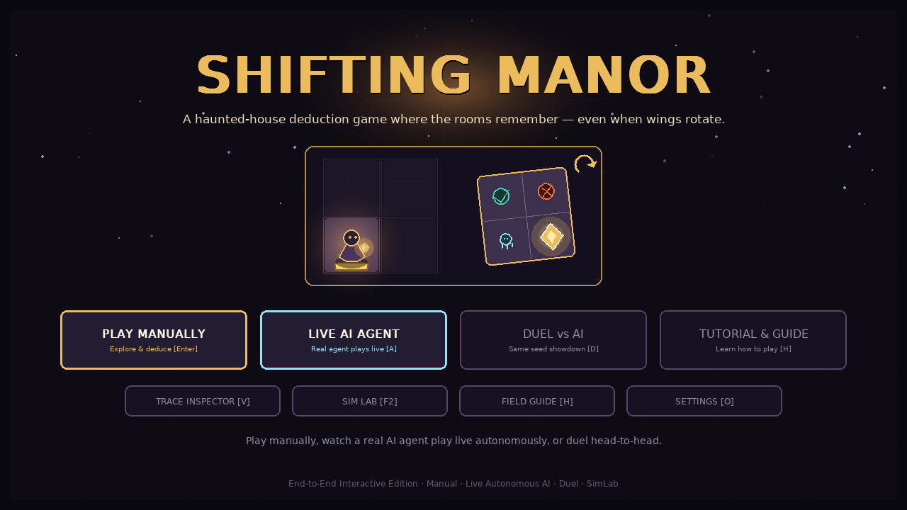

### Live Engine Gameplay & Autonomous AI Demo

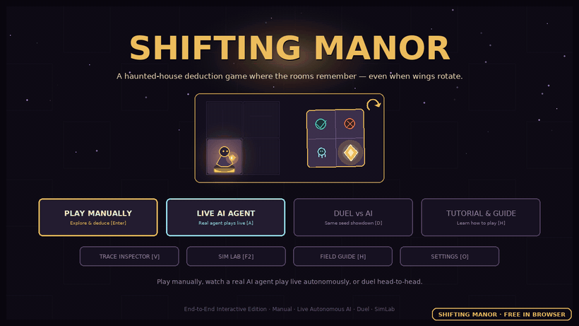

*Recorded directly from the live Python / pygame-ce engine: Title → Manual Lantern Fog & 90° Wing Shift → Real Autonomous Caretaker AI (`B3`) with R16 Knowledge Transport & Charm Ghost Banishment → 3★ Victory → 200-Seed Simulation Lab.*

</div>

---

## Table of Contents

- [Play Free Online (No Install)](#play-free-online-no-install)
- [Why Shifting Manor Is Fun](#why-shifting-manor-is-fun)
- [Visual Tour](#visual-tour)
- [AI Architecture & Forward Chaining](#ai-architecture--forward-chaining)
- [Empirical Evaluation & Optimality Audit](#empirical-evaluation--optimality-audit)
- [Local Quick Start](#local-quick-start)
- [Controls & How to Play](#controls--how-to-play)
- [Project Structure](#project-structure)
- [Development, Testing & Web Build](#development-testing--web-build)
- [Documentation Index](#documentation-index)

---

## Play Free Online (No Install)

Visit the **interactive landing page** (includes a zero-wait 3×3 Wing Shift sandbox, custom seed/agent launcher, and benchmark explorer) or jump straight into any mode via WebAssembly:

| Experience | Direct Link |
|---|---|
| **Interactive Landing Page + Sandbox** | **[muhammadghiffari.github.io/shifting-manor](https://muhammadghiffari.github.io/shifting-manor/)** |
| **Play Manually (Full Browser Game)** | [Launch Manual Play](https://muhammadghiffari.github.io/shifting-manor/play.html) |
| **Watch Real Caretaker AI (`B3`) Play Live** | [Launch Autonomous B3 on `HAUNT-4F2A`](https://muhammadghiffari.github.io/shifting-manor/play.html?auto=1&agent=b3&mode=explorer&seed=HAUNT-4F2A) |
| **Duel vs Caretaker AI (Same Seed)** | [Start Duel on `HAUNT-4F2A`](https://muhammadghiffari.github.io/shifting-manor/play.html?duel=1&mode=explorer&seed=HAUNT-4F2A) |
| **4-Lesson Interactive Tutorial** | [Play Hands-On Tutorial](https://muhammadghiffari.github.io/shifting-manor/play.html?tutorial=1) |
| **Simulation Lab (200-Seed Charts)** | [Open Simulation Lab](https://muhammadghiffari.github.io/shifting-manor/play.html?simlab=1) |

> **Tip:** Share any custom challenge link with friends using `?duel=1&mode=haunted&seed=YOUR-SEED`. Deterministic RNG guarantees the exact same map, hazards, and wing rotation schedule!

---

## Why Shifting Manor Is Fun

In classic Wumpus World, once you mark a room safe it stays safe forever. **Shifting Manor breaks that assumption cleanly:**

- **Atmospheric Lantern Deduction:** Explore dark rooms from Entrance `(0,0)` with flickering radial lantern light and finite oil. Quiet rooms prove all 4 orthogonal neighbours safe; **Breeze** warns of a Pit, **Chill** warns of the Ghost, and **Glimmer** signals the golden Heirloom.
- **The 90° Shifting Manor Twist:** On 6×6 boards (*Explorer* every 8 moves, *Haunted* every 5 moves), one of the three rotating 3×3 wings (**SE**, **NW**, **NE**; **Foyer SW** stays fixed) telegraphs a **Rumble** 2 actions ahead and rotates **90° CW or CCW** — moving hidden Pits and the Ghost to new coordinates while keeping the Heirloom fixed. Your placed notes rotate with the wing, and **standing inside a wing holds it still** as a tactical move.
- **Play Manually or Hand Over to a Real AI Anytime (`T`):** Play solo, request a fair zero-cheating **AI Hint (`I`)**, hit **`T`** mid-game to watch the real synced Caretaker AI autonomously finish your run, or challenge Caretaker `B3` head-to-head on the exact same seed in **Duel Mode**.
- **Read the Machine's Mind:** Every belief (`Safe`, `Pit`, `Ghost`, risk `%`) shares the exact same visual iconography as human notes, and clicking any room or firing line opens a full **`Why?` Proof Tree** back to the original percepts — even across wing rotations!

---

## Visual Tour

<table>
  <tr>
    <td width="50%">
      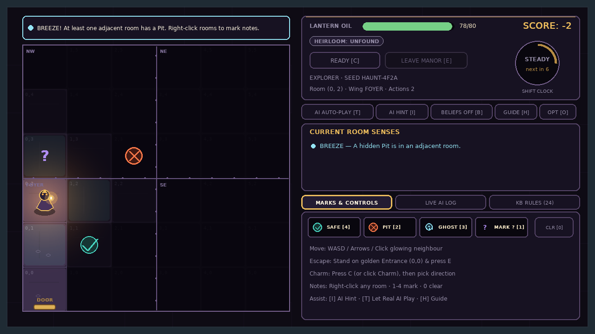
      <br />
      <strong>Manual Play &amp; Lantern Fog-of-War</strong><br />
      Flickering radial lantern light, remembered sense badges, clickable room marks, Shift Clock, and live contextual coaching.
    </td>
    <td width="50%">
      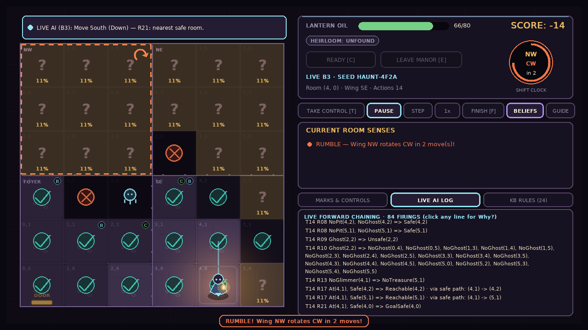
      <br />
      <strong>Real Autonomous Live AI (<code>B3</code>)</strong><br />
      Real agent playing live turn-by-turn with belief/risk overlay, planned stepping-stone route, wing telegraph arrow, and live rule firings.
    </td>
  </tr>
  <tr>
    <td width="50%">
      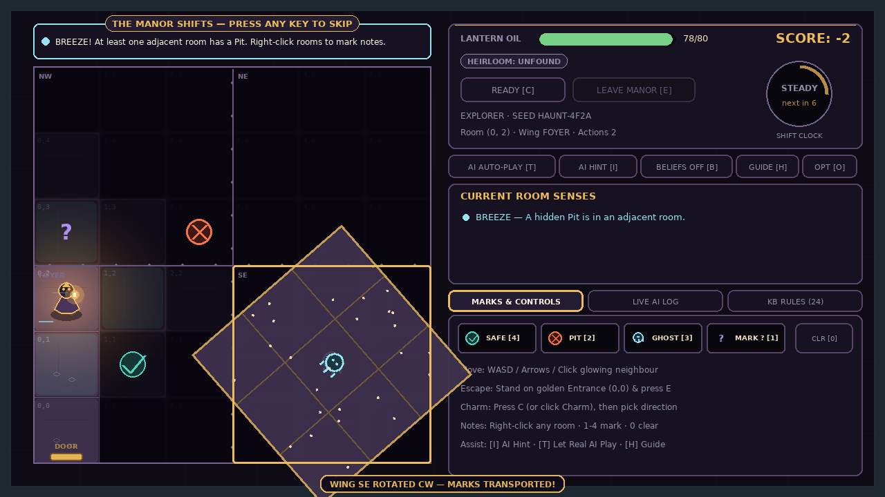
      <br />
      <strong>90° Wing Shift Choreography</strong><br />
      Hidden Pits, the Ghost, and player notes rotate smoothly together with stone-grinding audio and dust particles.
    </td>
    <td width="50%">
      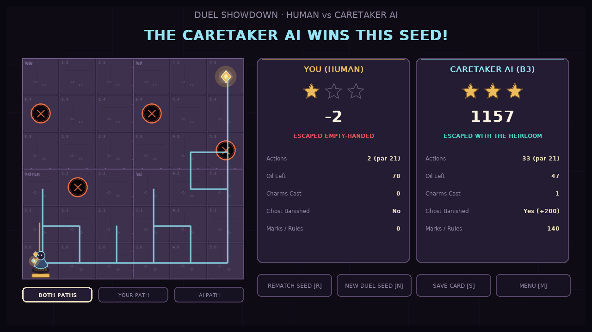
      <br />
      <strong>Human vs Caretaker AI Duel Showdown</strong><br />
      Play the exact same seed first, then watch Caretaker <code>B3</code> play live and compare revealed paths, stars vs Oracle par, and scores.
    </td>
  </tr>
  <tr>
    <td width="50%">
      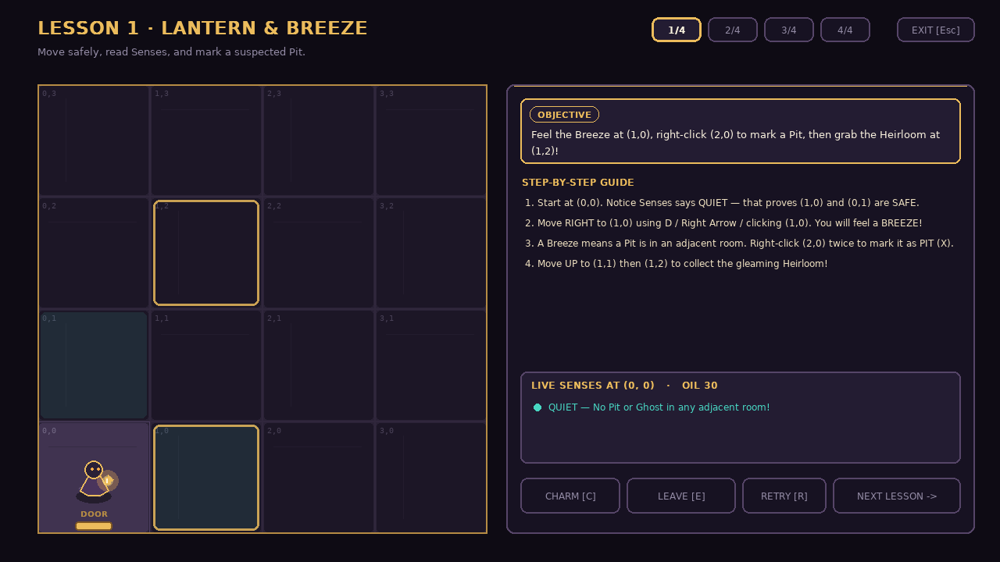
      <br />
      <strong>Interactive 4-Lesson Tutorial &amp; Guide (<code>H</code>)</strong><br />
      Hands-on playable mini-boards teaching Breeze, Pit triangulation, Ghost Charm banishment, and surviving a wing rotation.
    </td>
    <td width="50%">
      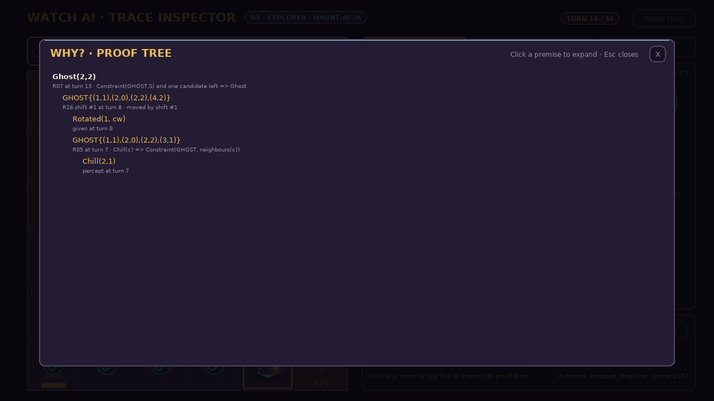
      <br />
      <strong>Explainable <code>Why?</code> Proof Trees</strong><br />
      Click any room or Inference Log row to trace every deduction through <code>R16</code> wing transports right back to raw percepts.
    </td>
  </tr>
</table>

<details>
<summary><strong>Watch AI Trace Inspector GIF &amp; Simulation Lab Screenshots</strong></summary>
<br />
<p align="center">
  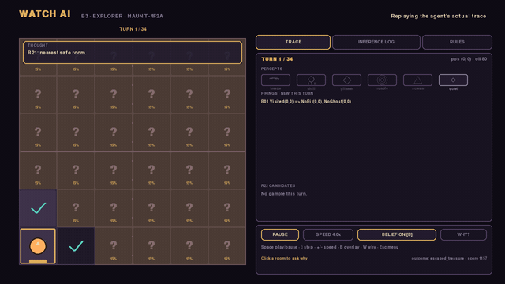
</p>
<table>
  <tr>
    <td width="50%">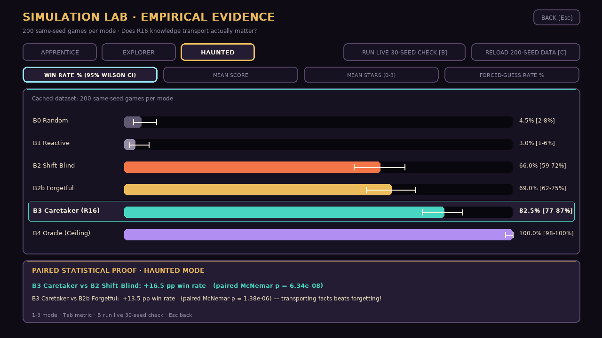<br /><em>Simulation Lab (<code>F2</code>): 200-seed bar charts + live benchmark runner</em></td>
    <td width="50%">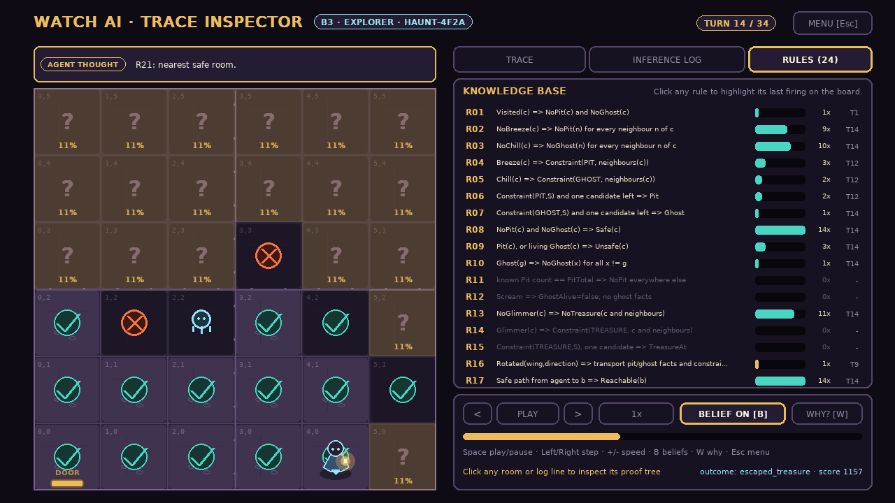<br /><em>Knowledge Base Tab: 24 IF–THEN rules with live firing heat bars</em></td>
  </tr>
</table>
</details>

---

## AI Architecture & Forward Chaining

Built for the Artificial Intelligence course (*Week 6 — Knowledge-Based Agents & Expert Systems*), the core engine (`engine/`, `kb/`, `agents/`, `sim/`) is **100% pure Python** with zero `pygame` imports and strict deterministic RNG per seed.

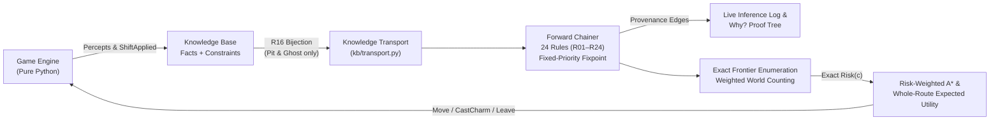

### Real Agents Included (Playable Live & Benchmarked)

| Agent | Strategy | Purpose |
|---|---|---|
| **`B0` Random** | Uniform random legal actions | Lower baseline |
| **`B1` Reactive** | Memoryless reflex; avoids immediate Breeze/Chill neighbours | Memoryless baseline |
| **`B2` Shift-Blind KB** | Full R01–R24 KB, **ignores `R16`** after wing shifts | Proves stale knowledge kills |
| **`B2b` Forgetful KB** | Full KB, **drops all facts** in rotated wing on shift | Proves forgetting loses value |
| **`B3` Caretaker AI** | **Full R01–R24 + `R16` Transport + Exact Enumeration + Risk-Weighted A\*** | **Flagship expert system** |
| **`B5` Exact Bayesian** | Same policy as `B3` fed exact global Bayesian posterior over initial worlds | Optimality audit reference |
| **`B4` Oracle** | Sees full true map & applies shifts | Theoretical upper bound / star par |

---

## Empirical Evaluation & Optimality Audit

### 200 Same-Seed Paired Benchmark (`sim/results.json`)

| Mode | Grid &amp; Shift | `B0` Random | `B1` Reactive | `B2` Shift-Blind | `B2b` Forgetful | **`B3` Caretaker (`R16`)** | `B4` Oracle | `B3` vs `B2` (McNemar) |
|---|---|---:|---:|---:|---:|---:|---:|---:|
| **Apprentice** | 4×4 · No shifts | 5.0% | 3.5% | 94.5% | 94.5% | **94.5%** | 100.0% | identical (`p = 1.0`) |
| **Explorer** | 6×6 · Shift / 8 | 4.5% | 3.5% | 77.5% | 83.5% | **91.5%** | 100.0% | **+14.0 pp (`p = 1.8×10⁻⁶`)** |
| **Haunted** | 6×6 · Shift / 5 | 4.5% | 3.0% | 66.0% | 69.0% | **82.5%** | 100.0% | **+16.5 pp (`p = 6.3×10⁻⁸`)** |

### 1,000-Seed/Mode Exact-Posterior Optimality Audit ([`docs/OPTIMALITY_AUDIT.md`](docs/OPTIMALITY_AUDIT.md))

- **B3 Win Rates (out-of-sample `SIM-<MODE>-10000..10999`):** **94.9%** (Apprentice) · **91.9%** (Explorer) · **82.7%** (Haunted)
- **Failure Classification:** Out of 3,000 games, **0 avoidable losses** and **0 suboptimal gambles** — every remaining loss is a mathematically forced uncertainty guess.
- **Exact Posterior Parity:** **B3 ≡ B5** (`0/0` discordant pairs across all 3 modes, `p = 1.0`), with risk calibration MAE `0.0024–0.0045` vs exact ground truth.

---

## Local Quick Start

Requires **Python 3.11+**. Works completely offline on Linux, macOS, and Windows.

```bash
# 1. Clone and install
git clone https://github.com/muhammadghiffari/shifting-manor.git
cd shifting-manor
python -m venv .venv && source .venv/bin/activate   # Windows: .venv\Scripts\activate
pip install -e ".[dev]"

# 2. Launch the full interactive game (Title Screen)
python -m shifting_manor

# 3. Or launch directly into a specific mode
python -m shifting_manor --auto --agent b3 --mode explorer --seed HAUNT-4F2A   # Live Autonomous AI
python -m shifting_manor --duel --mode explorer --seed HAUNT-4F2A              # Human vs AI Duel
python -m shifting_manor --tutorial                                            # 4-Lesson Tutorial
python -m shifting_manor --simlab                                              # Simulation Lab
python -m shifting_manor --demo --seed HAUNT-4F2A                              # Looping Demo Mode

# 4. Headless CLI trace demo & batch evaluation
python -m shifting_manor.cli --agent b3 --mode explorer --seed HAUNT-4F2A --verbose
python -m shifting_manor.sim --runs 200 --out sim/results.json
```

---

## Controls & How to Play

| Action | Keyboard / Mouse |
|---|---|
| **Move** | `WASD` / Arrow keys / Left-click any glowing adjacent room |
| **Leave Manor (Win / Escape)** | Stand on golden Entrance `(0,0)` and press `E` (or click `LEAVE MANOR [E]`) |
| **Cast Charm (1/game, full line)** | Press `C` (or click `CHARM`), then Arrow / `WASD` / click direction |
| **Mark Room Notes** | Right-click any room to cycle `?` → `Pit` → `Ghost` → `Safe`; or `1–4` / `0` clear |
| **Toggle Live Autonomous AI** | `T` — hand over to / reclaim manual control from the real agent mid-game! |
| **Fair AI Hint (Manual Play)** | `I` — zero-cheating recommendation from synced `B3` |
| **Toggle Belief & Risk Overlay** | `B` |
| **Live AI / Watch Playback** | `Space` pause/play · `Left`/`Right` step · `+`/`-` speed (`0.5×–4×`) · `F` fast-finish |
| **Inspect `Why?` Proof Tree** | `W` or click any room / Inference Log row |
| **Field Guide / Settings** | `H` (4-tab How-To-Play) · `O` (Audio, Reduce Motion, High Contrast, Font Scale) |
| **Sim Lab / Presenter HUD / Card** | `F2` (SimLab) · `F1` (Presenter Overlay) · `S` (Save Run Card PNG on Result) |
| **Restart / New Seed / Fullscreen** | `R` / `N` / `F11` · `Esc` pause/back |

---

## Project Structure

```text
shifting-manor/
├── shifting_manor/
│   ├── engine/       # Pure-Python game rules, seeded generator, 90° wing shift & validation
│   ├── kb/           # Facts, constraints, 24 Rule objects (R01–R24), forward chainer, R16 transport, exact enumeration
│   ├── agents/       # B0 random, B1 reactive, B2/B2b/B3 KBAgent, B4 oracle, B5 exact posterior, risk-weighted A*
│   ├── sim/          # Headless multi-seed batch runner, Wilson CI, McNemar, gamble calibration
│   ├── ui/           # pygame-ce scenes: app, live_ai, watch, tutorial, guide, simlab, settings, fx, audio, theme
│   ├── trace.py      # Deterministic frozen TraceStore & ProofNode builder (no pygame)
│   └── cli.py        # Text-mode percepts → rules fired → action demo
├── web/
│   ├── landing.html  # Interactive gothic landing page + 3×3 Shift Sandbox + Custom Launcher
│   └── main.py       # Async pygbag WebAssembly entry point with URL query routing
├── tools/            # build_web.py (pygbag bundler), posterior.py, audit.py, make_gif.py
├── tests/            # 291 automated unit, property, fuzz, mutation, UI, CLI & web-build tests
├── assets/           # Open-licensed DejaVu fonts, manifest & CREDITS.md
└── docs/             # PRD, ALGORITHMS, EVALUATION, OPTIMALITY_AUDIT, CODE_TOUR, QA, screens
```

---

## Development, Testing & Web Build

```bash
# Run full test suite (291 tests, headless via SDL dummy driver)
SDL_VIDEODRIVER=dummy SDL_AUDIODRIVER=dummy pytest -q

# Lint and formatting check
ruff check . && ruff format --check .

# Build the WebAssembly web bundle + itch.io zip locally (requires pygbag)
pip install pygbag
python -m tools.build_web --out dist/web
# Preview locally:
python -m http.server 8000 -d dist/web
```

---

## Documentation Index

| Document | Contents |
|---|---|
| [`docs/PRD.md`](docs/PRD.md) | Full product requirements, game rules, UX & algorithm rationale |
| [`docs/ALGORITHMS.md`](docs/ALGORITHMS.md) | Why forward chaining + exact enumeration + risk-weighted A* |
| [`docs/EVALUATION.md`](docs/EVALUATION.md) | 200-seed statistical evaluation (Wilson CIs & paired McNemar) |
| [`docs/OPTIMALITY_AUDIT.md`](docs/OPTIMALITY_AUDIT.md) | 1,000-seed/mode exact Bayesian posterior audit (`0` avoidable losses) |
| [`docs/FORWARD_CHAINING_WALKTHROUGH.md`](docs/FORWARD_CHAINING_WALKTHROUGH.md) | Turn-by-turn walkthrough of rules R01–R24 |
| [`docs/CODE_TOUR.md`](docs/CODE_TOUR.md) | Architecture and file-by-file code tour |
| [`docs/DEMO_SCRIPT.md`](docs/DEMO_SCRIPT.md) · [`docs/QA.md`](docs/QA.md) | Live presentation script & lecturer Q&A |
| [`STATUS.md`](STATUS.md) · [`DECISIONS.md`](DECISIONS.md) | Milestone status and architectural decision log |

---

## Author & License

Built by **Muhammad Ghiffari** (2026).  
Code is licensed under the [MIT License](LICENSE). Bundled font licenses are tracked in [`assets/CREDITS.md`](assets/CREDITS.md).
